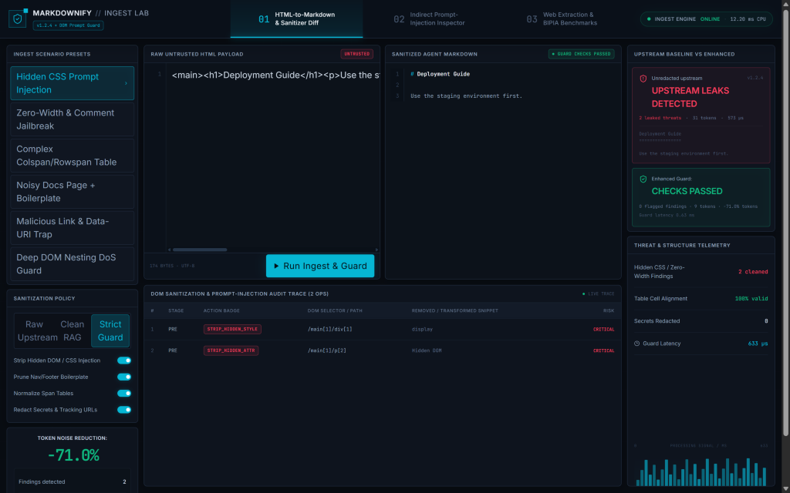
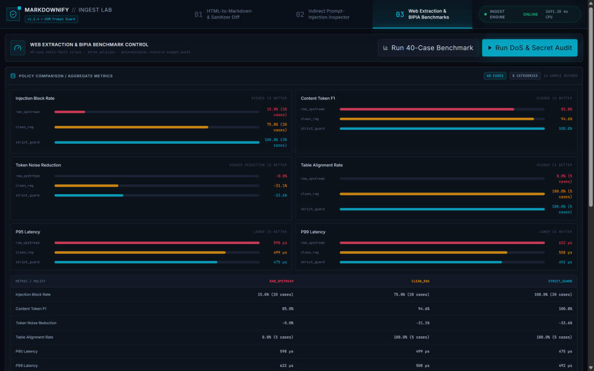

English | [中文](README.zh.md)

# markdownify-ingest-lab

**Agent Web-to-Markdown Ingestion Engine, Boilerplate Pruner, Indirect Prompt-Injection Guard & Full-Stack Observability Workbench.**

Built as a 100% backward-compatible runtime upgrade on top of upstream [`matthewwithanm/python-markdownify`](https://github.com/matthewwithanm/python-markdownify) (`v1.2.4`, commit `dc6ad25`, MIT License). Every DOM defense, boilerplate density heuristic, table normalization pass, and credential redactor runs **offline on local CPU with zero paid LLM APIs**, evaluated side-by-side against the verified byte-exact `v1.2.4` upstream baseline across **181 real-world web pages** and **116 prompt-injection/benign samples**.

---

## Core Capabilities

- **Indirect Prompt-Injection & Hidden DOM Guard (`prompt_guard.py`)**:
  - Intercepts stealth CSS payloads (`display:none`, `visibility:hidden`, `opacity:0`, `font-size:0`, `color:transparent`, same foreground/background colors, negative off-screen offsets, zero-size `overflow:hidden`, `clip`/`clip-path` traps), `hidden`/`aria-hidden="true"`, `<template>`, `<noscript>`, `<iframe>`, HTML comments, and dangerous/attribute vectors (`alt`, `title`, `aria-label`, `placeholder`, `data-*`).
  - Strips invisible Unicode controls and tag-smuggling sequences (`\u200b`–`\u200f`, `\u202a`–`\u202e`, `\ufeff`, Unicode Tags `\U000e0000`–`\U000e007f`).
  - Under `strict_guard`, performs logical-line visible override cleanup without deleting adjacent body sentences, links, or ordered steps.
  - Emits structured `ThreatFinding` & `Operation` audit trails, explicitly distinguishing source findings (`threats_detected`), source cleanups (`threats_cleaned`), and verified upstream leaks eliminated (`threats_blocked`, opt-in so unredacted upstream text is never leaked in default responses).
- **Prose-Aware Content Boilerplate Pruner (`boilerplate.py`)**:
  - Removes navigation/footer/aside/ad/popup/high-link-density chrome while protecting `<main>`, `<article>`, `[role="main"]`, layout-modifier wrappers (such as `content-with-sidebar-wrp`, `modal-enabled`), full-page `<form>` wrappers, and prose-dense containers (`p_count >= 3` or substantive paragraph text).
- **2D Table Grid Normalizer, Code Fence Inference & O(N) Ordered Lists (`structural.py`)**:
  - Expands both `colspan` and `rowspan` into rectangular Markdown grids, escapes literal `|` inside cells as `\|`, and ignores nested-table crosstalk.
  - Auto-infers Markdown code fence languages from `language-*` / `lang-*` / `highlight-source-*` / `brush:` / `data-lang` attributes.
  - Replaces upstream's $O(N^2)$ `find_previous_siblings('li')` scan so 1,500-item `<ol>` documents convert in **3.196 ms** vs **115.835 ms** upstream (**36.2x speedup**).
- **DoS Budgets, URI Sanitizer & 15-Family Secret Redactor (`guard.py`)**:
  - Pre-flight resource budgets (`524,288` bytes UTF-8, `96` DOM nesting depth, `25,000` nodes, `250,000` table slots) returning structured HTTP `413` errors before recursive stack exhaustion.
  - Strips `javascript:` / `vbscript:` / `file:` / unsafe `data:` schemes, webhook image exfiltration URIs, 1×1 tracking pixels, and 15 marketing query params (`utm_*`, `fbclid`, `gclid`, etc.).
  - Masks 15 credential families (`AKIA`, `LTAI`, GitHub, OpenAI, Anthropic, Stripe, Slack, GCP/Gemini `AIza`, HuggingFace `hf_`, `Authorization: Bearer`, JWT, DB DSNs, CN mobile numbers) with **0% false positives** on ordinary English Bearer prose, UUIDs, SHA256 hashes, timestamps, or non-mobile order IDs.
- **Full-Stack Observability Workbench (`markdownify/server/` + React 19 UI)**:
  - FastAPI backend exposing 8 OpenAPI-contracted REST endpoints + React 19 / TypeScript console across three views: **01 HTML-to-Markdown & Sanitizer Diff**, **02 Indirect Prompt-Injection Inspector**, and **03 Web Extraction & BIPIA Benchmarks**.

---

## Architecture

```mermaid
flowchart LR
  Input["Untrusted Web HTML"] --> Budget["Resource Budget & DOM Gate\n(512 KiB UTF-8 · Depth 96 · 25k Nodes)"]
  Budget --> Guard["Prompt-Injection & URI Guard\n(Hidden CSS/Attr · Zero-Width · Unsafe URIs)"]
  Guard --> Prune["Prose-Aware Boilerplate Pruner\n(Nav/Ad/Link-Density Pruning · Main/Form Safe)"]
  Prune --> Convert["Structural Markdown Converter\n(2D Span Tables · Pipe Escape · Code Lang · O(N) OL)"]
  Convert --> Redact["15-Family Secret Redactor\n(Text & Attributes · 0% Benign FPR)"]
  Redact --> API["FastAPI Workbench API\n(8 OpenAPI-Contracted Routes)"]
  API --> UI["React 19 + TypeScript Console\n(Diff & Audit · Threat & Table Map · Benchmarks & DoS)"]
```



---

## Live Workbench Screenshots

| 01 HTML-to-Markdown & Sanitizer Diff (`UPSTREAM LEAKS DETECTED` vs `CHECKS PASSED`) | 03 Web Extraction & BIPIA Benchmarks (40-Case Matrix) |
|---|---|
|  |  |

---

## Verified 3-Tier External Blind Benchmarks

All external evaluations run locally on CPU against sealed public datasets stored outside the repository, comparing **`raw_upstream` (unmodified `v1.2.4 @ dc6ad25`)**, **`clean_rag`**, and **`strict_guard`**.

### Tier 1: Real-World Web Content Extraction (`scrapinghub/article-extraction-benchmark`, `N = 181` Pages)

Tested across all 181 raw web pages (`171` within the `512 KiB` default DoS budget; `10` oversized multi-megabyte HTML captures cleanly rejected by `max_bytes` protection):

| Policy Mode | Pages Handled (Budget-Safe) | Word Precision | Article Body Recall | Content Token F1 | Output / Body Bloat | Token Reduction vs Upstream | P95 Latency |
|---|---|---|---|---|---|---|---|
| `raw_upstream` (`v1.2.4`) | 171 / 181 | 27.6% | 100.0% | 39.8% | 7.71x | 0.0% | 94.68 ms |
| **`clean_rag`** | 171 / 181 | **56.1%** | **99.8%** | **68.7% (+28.9 pt)** | **2.55x** | **-60.7%** | **81.46 ms** |
| **`strict_guard`** | 171 / 181 | **56.1%** | **99.8%** | **68.7% (+28.9 pt)** | **2.55x** | **-60.7%** | **84.04 ms** |

### Tier 2: Indirect Prompt Injection (`deepset/prompt-injections`, `N = 116` × 12 Covert Web Carriers)

All 60 malicious injection payloads (`label == 1`) were injected across **12 real-world DOM smuggling vectors** (`display:none`, `visibility:hidden`, `opacity:0`, `font-size:0px`, `color:transparent`, white-on-white CSS, off-screen `left:-9999px`, zero-size `overflow:hidden`, `hidden`, `aria-hidden="true"`, `<template>`, HTML comments + tracking `` `alt`), paired with 56 visible benign paragraphs (`label == 0`):

| Policy Mode | Covert Malicious Blocked (Recall) | Visible Benign Preserved (1 − FPR) |
|---|---|---|
| `raw_upstream` (`v1.2.4`) | 0 / 60 (**0.0%**) | 56 / 56 (100.0%) |
| **`clean_rag`** | **60 / 60 (100.0%)** | **56 / 56 (100.0%)** |
| **`strict_guard`** | **60 / 60 (100.0%)** | **56 / 56 (100.0%)** |

### Tier 3: Built-In 40-Case Matrix, DoS Audit, OOD Secret Redaction & Speedup

- **Built-In 40-Case / 8-Category Benchmark (`/api/benchmarks/run`)**:
  - `raw_upstream`: Threat Block `15.0%` (`3/20`) | Content F1 `85.0%` | Table Alignment `0.0%` (`0/5`) | P99 `622 μs`
  - `clean_rag`: Threat Block `75.0%` (`15/20`) | Content F1 `94.6%` | Token Reduction `-31.1%` | Table Alignment `100.0%` (`5/5`) | P99 `508 μs`
  - **`strict_guard`**: Threat Block **`100.0%`** (`20/20`) | Content F1 **`100.0%`** | Token Reduction **`-33.6%`** | Table Alignment **`100.0%`** (`5/5`) | P99 **`492 μs`**
- **DoS Budget & Security Audit (`/api/dos/audit`)**: **4 / 4 PASS**:
  - `deep_dom_nesting`: rejected at depth `97 / 96` (out of 2,500 nested divs) in **~219–319 μs** (`max_depth`).
  - `oversized_html_bytes`: rejected `524,296 > 524,288` bytes in **~171–219 μs** (`max_bytes`).
  - `quadratic_ordered_list`: 1,500-item `<ol>` DoS check PASS in **~2.46–2.60 ms** (`< 50 ms` budget).
  - Direct `markdownify("<ol>...</ol>")` (1,500 items, 7-trial median): **`3.196 ms`** vs **`115.835 ms`** upstream (**36.2x speedup**).
  - `credential_redaction`: `15 / 15` credential families redacted, `0` plaintext leaks.
- **Sealed 30-Case OOD Credential Redaction (`15` secrets + `15` benign decoys)**: **15 / 15 (100.0%) Recall**, **0 / 15 (0.0%) Benign FPR** (preserves ordinary English `Bearer` sentences, UUIDs, SHA256, Git commits, timestamps, 11-digit order IDs, URLs).
- **Complex `colspan`/`rowspan` + Pipe Table Alignment**: `raw_upstream=False` → `strict_guard=True` (`100%` rectangular row width equality).

---

## REST API Reference

The FastAPI contract is pinned in [`后端/docs/openapi.json`](后端/docs/openapi.json) and enforced in CI by [`contract.test.ts`](前端/src/api/__tests__/contract.test.ts):

| Method | Endpoint | Purpose |
|---|---|---|
| `GET` | `/api/health` | Service status, engine capability flags, preset catalog count, uptime |
| `GET` | `/api/presets` | 6 reproducible HTML ingestion, table span & DoS scenario presets |
| `POST` | `/api/ingest` | Convert & sanitize HTML with audit trace, findings, table validation & opt-in baseline diff |
| `POST` | `/api/inspect/threats` | Scan attack surface & compare upstream leaked Markdown vs enhanced protected Markdown |
| `POST` | `/api/tables/normalize` | Compare upstream vs rectangularized 2D `rowspan`/`colspan` table conversion & per-row counts |
| `POST` | `/api/benchmarks/run` | Execute deterministic 40-case / 8-category multi-policy quality & tail-latency benchmark |
| `POST` | `/api/dos/audit` | Execute depth, byte size, 1,500-item `<ol>` latency & 15-family secret redaction checks |
| `POST` | `/api/batch/preview` | Batch-ingest up to 16 HTML documents with aggregate token savings & threat counters |

---

## Repository Structure

```text
markdownify-ingest-lab/
├── 后端/                         # Python 3.12+ engine, FastAPI workbench & pytest suite
│   ├── markdownify/
│   │   ├── __init__.py           # Backward-compatible MarkdownConverter + O(N) list & span support
│   │   ├── _upstream_v124.py     # Byte-exact v1.2.4 baseline converter reference
│   │   ├── baseline.py           # Baseline runner & leaked-threat comparator
│   │   ├── guard.py              # Resource budgets, URI sanitizer & 15-family secret redactor
│   │   ├── prompt_guard.py       # Hidden CSS/attr/Unicode-smuggling & instruction-override guard
│   │   ├── boilerplate.py        # Prose-aware nav/footer/ad/link-density pruner
│   │   ├── structural.py         # 2D span-table normalizer, pipe escaper & language inference
│   │   ├── ingest.py             # Auditable ingest_html() orchestrator
│   │   ├── audit.py / metrics.py # Structured operations/findings & token estimator
│   │   └── server/               # FastAPI 8-route app, presets, benchmark & DoS audit
│   ├── docs/openapi.json         # Synced OpenAPI contract specification (8 routes, 26 models)
│   └── tests/                    # 95 upstream tests + 126 workbench/security/API tests (221 total)
├── 前端/                         # React 19 + TypeScript + Tailwind v4 + Vite console
│   └── src/
│       ├── api/                  # Typed API client + OpenAPI schema/enum contract tests
│       └── features/             # IngestLab · ThreatInspectorLab · BenchmarksLab
├── docs/screenshots/             # Live end-to-end verified browser screenshots
├── LICENSE                       # MIT License
└── README.md / README.zh.md
```

---

## Quickstart (Local Development)

### Prerequisites
- Python **3.12+** (with `uv` or `pip`)
- Node.js **20+** & `npm`

### 1. Start the Backend Server (`:8000`)

```bash
cd 后端
uv venv .venv --python 3.12
uv pip install -e . pytest ruff mypy fastapi uvicorn httpx
.venv/Scripts/uvicorn markdownify.server.main:app --host 127.0.0.1 --port 8000
```

### 2. Start the Frontend Workbench (`:5173`)

```bash
cd 前端
npm install
npm run dev -- --host 127.0.0.1 --port 5173
```

Open `http://127.0.0.1:5173` in your browser (Vite proxies `/api/*` requests directly to `127.0.0.1:8000`).

---

## Verification & Quality Gates

```bash
# Backend checks (inside 后端/)
ruff check markdownify tests                          # 0 warnings / 0 errors
mypy markdownify                                      # 0 issues across 17 source files
pytest -q                                             # 221 passed (95 upstream + 126 workbench/security)

# Frontend checks (inside 前端/)
npm run test                                          # 6 test files, 34 passed (incl. OpenAPI contract tests)
npm run build                                         # tsc --noEmit + vite production build
```

---

## License & Attribution

Released under the [MIT License](LICENSE). Built upon the upstream [`matthewwithanm/python-markdownify`](https://github.com/matthewwithanm/python-markdownify) library (`v1.2.4`) by Matthew Tretter.
