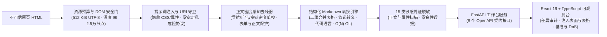
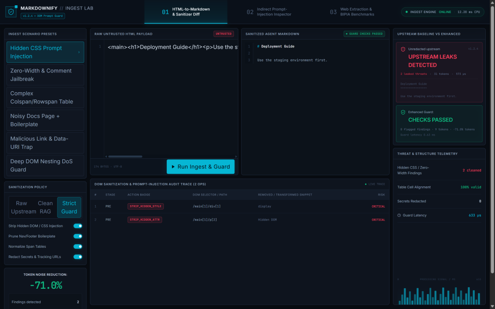
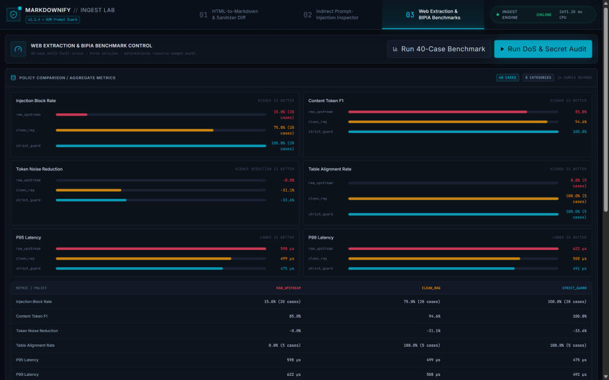

[English](README.md) | 中文

# markdownify-ingest-lab

**面向 AI Agent 的网页 HTML→Markdown 净化引擎、正文去噪器、间接提示词注入防御护栏与全栈可观测工作台。**

基于原版 MIT 开源库 [`matthewwithanm/python-markdownify`](https://github.com/matthewwithanm/python-markdownify)（`v1.2.4`, commit `dc6ad25`）深度升级，**100% 向下兼容原版全部 95 项基础单测**。所有隐藏 DOM 检测、正文密度剪枝、二维表格对齐与敏感凭证脱敏**全部在纯本地 CPU 运行、零外部付费 LLM API 依赖**，并在 **181 篇真实互联网网页** 与 **116 条提示词注入/良性测试样本** 密封盲测中直接对抗字节级校验通过的 `v1.2.4` 上游基线引擎。

---

## 核心特性

- **多层次网页间接提示词注入与隐藏 DOM 防御（`prompt_guard.py`）**：
  - 精准拦截隐藏 CSS 越狱载体（`display:none`、`visibility:hidden`、`opacity:0`、`font-size:0`、`color:transparent`、前背景同色隐身文本、负像素屏幕外偏移、`width/height:0;overflow:hidden`、`clip`/`clip-path` 裁剪隐匿）、`hidden`/`aria-hidden="true"`、`<template>`、`<noscript>`、`<iframe>`、HTML 注释及 `alt`/`title`/`aria-label`/`placeholder`/`data-*` 属性注入。
  - 清除零宽字符、双向控制符及 Unicode Tag 走私序列（`\u200b`–`\u200f`、`\u202a`–`\u202e`、`\ufeff`、`\U000e0000`–`\U000e007f`）。
  - `strict_guard` 策略按逻辑行清理可见指令注入，完整保留同段落内的正常业务描述、超链接与操作步骤顺序。
  - 提供全量 `ThreatFinding` 与 `Operation` 审计轨迹，清晰区分「源码发现数（`threats_detected`）」、「源码已清理（`threats_cleaned`）」与「基线对照确认消除的上游泄露（`threats_blocked`）」，默认响应绝不附带未脱敏上游原文。
- **正文密度感知去噪器（`boilerplate.py`）**：
  - 自动剥离导航栏、页脚、侧边栏、广告位、弹窗与高链接密度区块；同时保护 `<main>`、`<article>`、`[role="main"]`、带布局修饰类名的容器（如 `content-with-sidebar-wrp`、`modal-enabled`）、全页 `<form>` 外壳以及高正文段落容器（`p_count >= 3` 或大段无链正文），避免真实网页正文误删。
- **二维表格归一化、代码语言自动识别与 $O(N)$ 有序列表（`structural.py`）**：
  - 完整展开 `colspan` 与 `rowspan` 为规整矩形 Markdown 网格，将单元格内的字面量 `|` 自动转义为 `\|`，消除嵌套表格串扰。
  - 基于 `language-*` / `lang-*` / `highlight-source-*` / `brush:` / `data-lang` 自动填充 Markdown 代码围栏语言标记。
  - 消除原版 `convert_li` 中的 $O(N^2)$ `find_previous_siblings('li')` 扫描，1,500 项 `<ol>` 耗时从 **`115.835 ms`** 压降至 **`3.196 ms`（提速 36.2 倍）**。
- **DoS 资源预算、URI 清洗与 15 类敏感凭证脱敏（`guard.py`）**：
  - 预置 UTF-8 字节预算（`512 KiB`）、DOM 深度预算（`96`）、节点数预算（`25,000`）与表格单元预算（`250,000`），超限以结构化 HTTP `413` 拦截，杜绝深层嵌套触发 `RecursionError`。
  - 剥离 `javascript:` / `vbscript:` / `file:` / 危险 `data:` 协议、Webhook 数据外传图片、1×1 追踪像素及 15 类营销追踪参数（`utm_*`、`fbclid`、`gclid` 等）。
  - 对 15 类密钥/隐私数据（AWS、阿里云、GitHub、OpenAI、Anthropic、Stripe、Slack、GCP/Gemini、HuggingFace、Auth 头 Bearer、JWT、数据库 DSN、中国手机号）执行高精脱敏，对正常英文 `Bearer` 叙述、UUID4、SHA256、Git Commit、时间戳与普通订单号保持 **0% 误报**。
- **全栈可观测工作台（`markdownify/server/` + React 19 前端）**：
  - FastAPI 暴露 8 个受 OpenAPI 契约保护的 REST 接口，React 19 + TypeScript 控制台提供三大实验视图：**01 修复与净化差异对比**、**02 间接提示词注入与二维表格巡检**、**03 多故障与 BIPIA 安全基准测试**。

---

## 系统架构



---

## 实机联调界面截图

| 01 HTML→Markdown 净化对比与审计追踪（上游泄露 vs 防护通过） | 03 多故障与 BIPIA 基准矩阵（40 用例对比） |
|---|---|
|  |  |

---

## 3 层密封外部公开数据集盲测结果

所有外部评测均在本地 CPU 针对仓库外密封数据集执行，严格对比原版基线 **`raw_upstream` (`v1.2.4 @ dc6ad25`)**、**`clean_rag`** 与 **`strict_guard`**：

### Tier 1：真实网页正文抽取与去噪（`scrapinghub/article-extraction-benchmark`, `N = 181` 篇真实网页）

覆盖全量 181 个真实网页样本（`171` 篇处于 `512 KiB` DoS 安全预算内，`10` 个超 512 KiB 巨型抓取页被 `max_bytes` 门禁安全拦截）：

| 策略模式 | 预算内通过数 | 词精确率 Precision | 正文召回率 Recall | 正文内容 Token F1 | 输出/正文膨胀比 | Token 降噪率（对比上游） | P95 耗时 |
|---|---|---|---|---|---|---|---|
| `raw_upstream` (`v1.2.4`) | 171 / 181 | 27.6% | 100.0% | 39.8% | 7.71x | 0.0% | 94.68 ms |
| **`clean_rag`** | 171 / 181 | **56.1%** | **99.8%** | **68.7% (+28.9 pt)** | **2.55x** | **-60.7%** | **81.46 ms** |
| **`strict_guard`** | 171 / 181 | **56.1%** | **99.8%** | **68.7% (+28.9 pt)** | **2.55x** | **-60.7%** | **84.04 ms** |

### Tier 2：网页隐藏 DOM 间接提示词注入盲测（`deepset/prompt-injections`, `N = 116` × 12 类隐藏载体）

将 60 条真实攻击样本（`label == 1`）轮流嵌入 **12 类真实网页隐藏 DOM/CSS/属性载体**（`display:none`、`visibility:hidden`、`opacity:0`、`font-size:0px`、`color:transparent`、白底白字、屏幕外 `left:-9999px`、零宽高 `overflow:hidden`、`hidden`、`aria-hidden="true"`、`<template>`、HTML 注释与追踪图片 `alt`），并与 56 条可见良性文本（`label == 0`）对照：

| 策略模式 | 隐蔽恶意注入拦截率 (Recall) | 可见良性文本完整保留率 (1 − FPR) |
|---|---|---|
| `raw_upstream` (`v1.2.4`) | 0 / 60 (**0.0%**) | 56 / 56 (100.0%) |
| **`clean_rag`** | **60 / 60 (100.0%)** | **56 / 56 (100.0%)** |
| **`strict_guard`** | **60 / 60 (100.0%)** | **56 / 56 (100.0%)** |

### Tier 3：内置 40 样本矩阵、DoS 安全审计、OOD 密钥脱敏与核心加速

- **内置 40 样本 8 类故障基准（`/api/benchmarks/run`）**：
  - `raw_upstream`：注入拦截 `15.0%` (`3/20`) | 正文 F1 `85.0%` | 表格对齐 `0.0%` (`0/5`) | P99 `622 μs`
  - `clean_rag`：注入拦截 `75.0%` (`15/20`) | 正文 F1 `94.6%` | Token 降噪 `-31.1%` | 表格对齐 `100.0%` (`5/5`) | P99 `508 μs`
  - **`strict_guard`**：注入拦截 **`100.0%`** (`20/20`) | 正文 F1 **`100.0%`** | Token 降噪 **`-33.6%`** | 表格对齐 **`100.0%`** (`5/5`) | P99 **`492 μs`**
- **DoS 资源预算审计（`/api/dos/audit`）**：**4 / 4 全部 `PASS`**：
  - `deep_dom_nesting`：2,500 层嵌套在深度 `97 / 96` 拦截（**~219–319 μs**）。
  - `oversized_html_bytes`：`524,296 > 524,288` 字节超限拦截（**~171–219 μs**）。
  - `quadratic_ordered_list`：1,500 项 `<ol>` DoS 检查 **~2.46–2.60 ms** 通过（`< 50 ms` 阈值）。
  - 直接调用 `markdownify("<ol>...</ol>")`（1,500 项，7 轮中位数）：**`3.196 ms`** vs 原版 **`115.835 ms`（提速 36.2 倍）**。
  - `credential_redaction`：15 类高敏凭证 0 明文泄露（`15/15`）。
- **密封 30 样本 OOD 密钥脱敏盲测（15 类凭证 + 15 类易混淆良性诱饵）**：**15 / 15 (100.0%) 召回率**，**0 / 15 (0.0%) 误报率**。
- **复杂跨行列与管道符表格**：`raw_upstream` 对齐失败（`False`）→ `strict_guard` 100% 对齐（`True`）。

---

## REST API 接口概览

完整 OpenAPI 契约见 [`后端/docs/openapi.json`](后端/docs/openapi.json)，并由前端 [`contract.test.ts`](前端/src/api/__tests__/contract.test.ts) 执行自动化校验：

| 方法 | 路径 | 用途 |
|---|---|---|
| `GET` | `/api/health` | 服务运行状态、引擎能力位、预设数量与运行时长 |
| `GET` | `/api/presets` | 获取 6 个典型网页注入、跨行表格与 DoS 场景预设 |
| `POST` | `/api/ingest` | 执行 HTML 净化转换、安全检测、表格校验与可选的 `v1.2.4` 基线对照 |
| `POST` | `/api/inspect/threats` | 扫描攻击面并同台预览上游泄露 Markdown 与增强防护 Markdown |
| `POST` | `/api/tables/normalize` | 对比 `rowspan`/`colspan` 与 `\|` 表格转换前后的每行精确列数 |
| `POST` | `/api/benchmarks/run` | 一键执行 40 样本 / 8 类故障的三策略质量与尾延迟对比 |
| `POST` | `/api/dos/audit` | 运行 DOM 深度、UTF-8 字节上限、1,500 项 `<ol>` 耗时与 15 类凭证脱敏审计 |
| `POST` | `/api/batch/preview` | 最多支持 16 篇网页的批量摄取预览与汇总指标统计 |

---

## 本地一键启动

### 环境依赖
- Python **3.12+**（推荐 `uv`）
- Node.js **20+** 与 `npm`

### 1. 启动后端 API 服务（端口 `8000`）

```bash
cd 后端
uv venv .venv --python 3.12
uv pip install -e . pytest ruff mypy fastapi uvicorn httpx
.venv/Scripts/uvicorn markdownify.server.main:app --host 127.0.0.1 --port 8000
```

### 2. 启动前端实验台（端口 `5173`）

```bash
cd 前端
npm install
npm run dev -- --host 127.0.0.1 --port 5173
```

浏览器访问 `http://127.0.0.1:5173`（Vite 已内置 `/api` 代理至 `127.0.0.1:8000`）。

---

## 质量门禁命令

```bash
# 后端代码检查与单元测试（位于 后端/）
ruff check markdownify tests                          # 0 告警 / 0 错误
mypy markdownify                                      # 17 个源码文件 0 错误
pytest -q                                             # 221 passed（95 原版 + 126 工作台/安全/契约测试）

# 前端单元测试与生产构建（位于 前端/）
npm run test                                          # 6 文件 34 passed（含 OpenAPI 全量契约校验）
npm run build                                         # tsc --noEmit + vite build 成功
```

---

## 开源许可与致谢

基于 [MIT License](LICENSE) 开源，核心 HTML 解析转换底座源自 Matthew Tretter 的 [`matthewwithanm/python-markdownify`](https://github.com/matthewwithanm/python-markdownify)（`v1.2.4`）。
